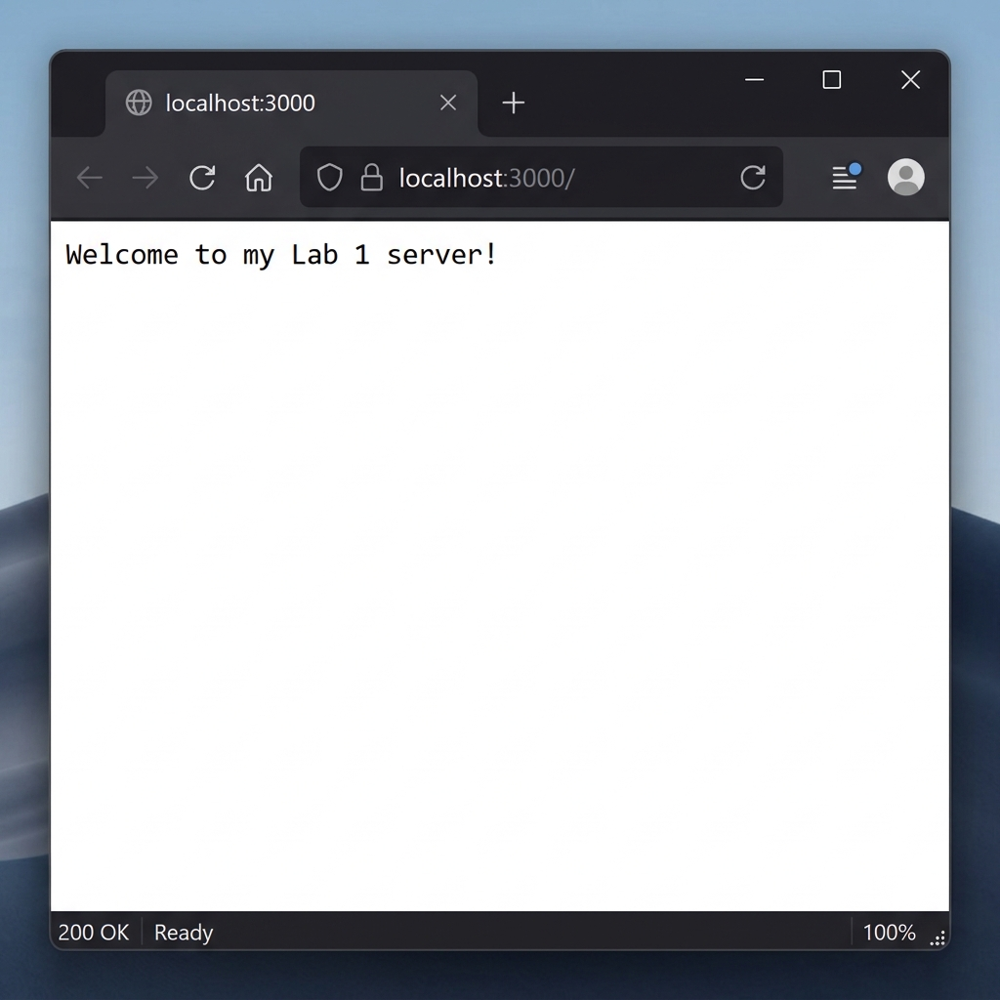
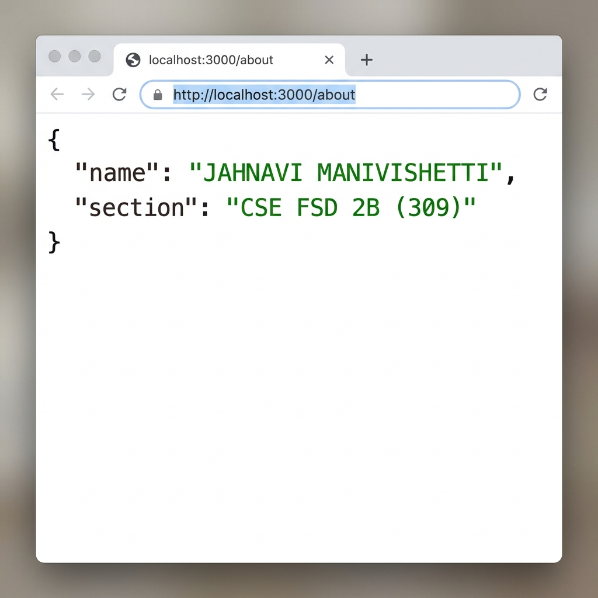
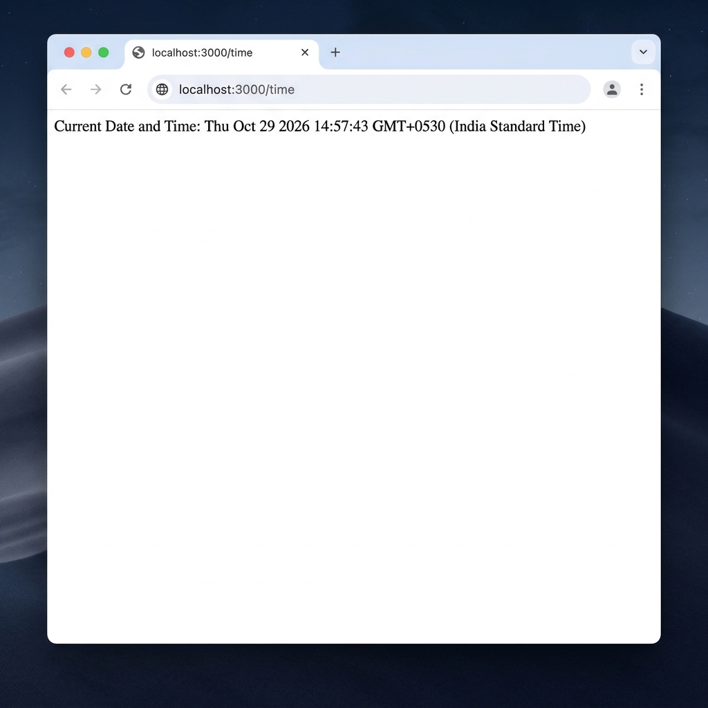
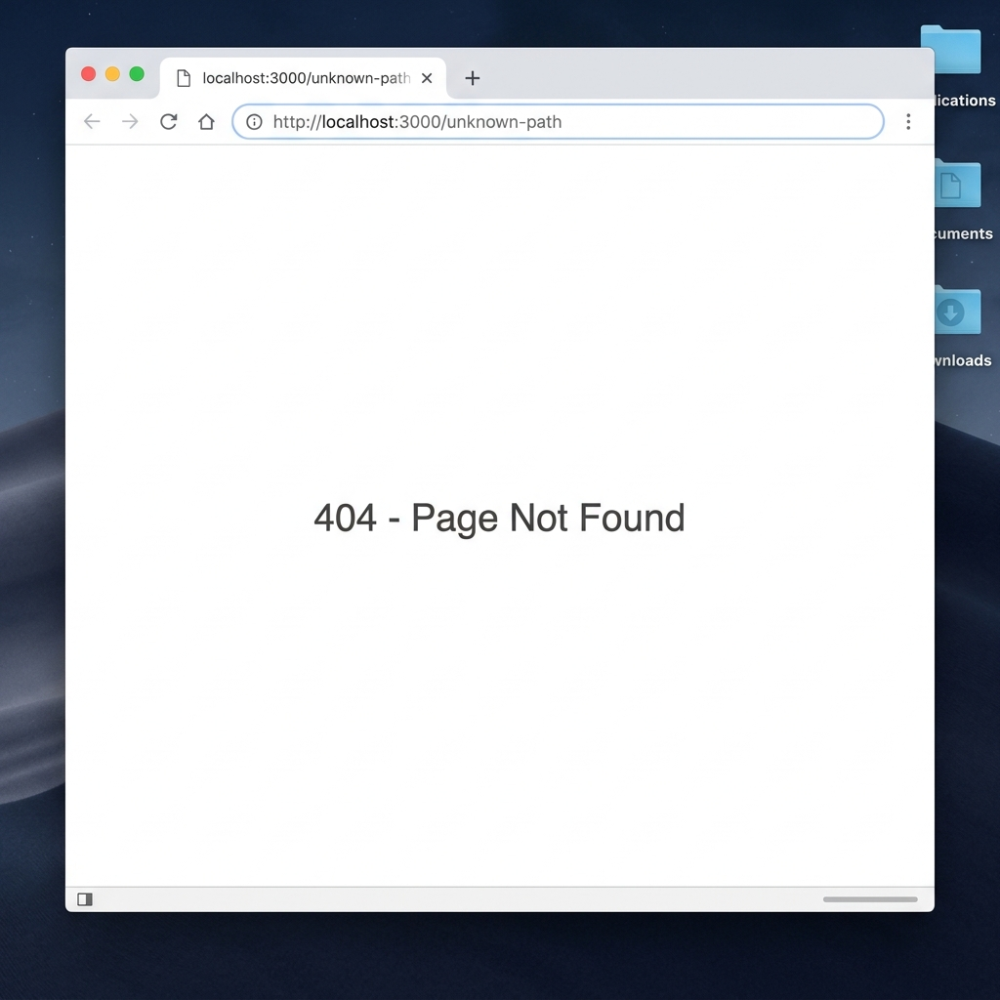

# Lab 1: Node.js and Express Server

## Student Details

- **Name:** Jahnavi Manivishetti
- **Registration Number:** 252U1R7061
- **Section:** CSE FSD 2B (309)
- **Course:** Backend Development Fundamentals
- **Lab Number:** 01
- **GitHub Repository:** [https://github.com/jahnavimanivisetti-rgb/lab-1](https://github.com/jahnavimanivisetti-rgb/lab-1)

## Live Link

Deployment is currently unavailable. This application requires a persistent Node.js runtime (e.g., Render, Railway, or Cyclic). Static hosting platforms such as GitHub Pages or Vercel's static tier cannot run a continuous Node.js/Express server. Deployment steps are listed at the end of this file.

## Objective

To set up a Node.js project, create a basic HTTP server using the built-in `http` module, and build an Express server with multiple routes and appropriate HTTP status codes.

## Technologies Used

- Node.js
- Express.js
- JavaScript
- npm
- Visual Studio Code

## Project Structure

```text
lab-01/
├── screenshots/
│   ├── home.png
│   ├── about.png
│   ├── time.png
│   └── not-found.png
├── server-http.js
├── server.js
├── package.json
├── package-lock.json
├── .gitignore
└── README.md
```

## package.json Fields Explained

| Field | Description |
|---|---|
| `name` | The name of the project (`lab-01`). Must be lowercase and URL-safe. |
| `version` | The current version of the project (`1.0.0`). Follows semantic versioning. |
| `main` | The entry point file of the project (`server-http.js`). |
| `scripts` | Shortcuts for npm commands. `start` runs `node server.js`. `test` is a placeholder. |
| `dependencies` | Lists packages the project needs to run — here, `express`. |
| `license` | The license type for the project (`ISC`). |

## Installation and Setup

### Prerequisites

- Node.js and npm installed
- Visual Studio Code or another code editor

### Steps to Run

1. Clone the repository or download the project.
2. Open the `lab-01` folder in the terminal.
3. Install the dependencies:

   ```bash
   npm install
   ```

4. Start the Express server:

   ```bash
   node server.js
   ```

5. Open the following URL in your browser:

   `http://localhost:3000`

### How to Run the Basic HTTP Server

To run the server implemented using Node.js's built-in HTTP module:

```bash
node server-http.js
```

Stop the running server with `Ctrl + C` before starting another server on the same port.

## Endpoints

| Method | Endpoint | Description | Expected Status |
|---|---|---|---|
| GET | `/` | Welcome message | 200 OK |
| GET | `/about` | Student name and section in JSON | 200 OK |
| GET | `/time` | Current date and time | 200 OK |
| GET | `/anything` | Unknown route demonstration | 404 Not Found |

> **Note:** `/anything` is an example route demonstrating 404 handling. All other undefined routes (such as `/hello`, `/test`, `/unknown-path`) also return `404 Not Found`.

### Route Testing and Expected Results

1. **GET `/`**
   - **How to test:** Open `http://localhost:3000/` in a browser or run `curl http://localhost:3000/`
   - **Expected Status:** `200 OK`
   - **Expected Result:** `Welcome to my Lab 1 server!`

2. **GET `/about`**
   - **How to test:** Open `http://localhost:3000/about` in a browser or run `curl http://localhost:3000/about`
   - **Expected Status:** `200 OK`
   - **Expected Result:** JSON object containing student name and section:
     ```json
     {
       "name": "JAHNAVI MANIVISHETTI",
       "section": "CSE FSD 2B (309)"
     }
     ```

3. **GET `/time`**
   - **How to test:** Open `http://localhost:3000/time` in a browser or run `curl http://localhost:3000/time`
   - **Expected Status:** `200 OK`
   - **Expected Result:** `Current Date and Time: <current-system-date-time>`

4. **GET `/anything` (or any undefined route)**
   - **How to test:** Open `http://localhost:3000/anything` or `http://localhost:3000/unknown-path` in a browser
   - **Expected Status:** `404 Not Found`
   - **Expected Result:** `404 - Page Not Found`

## Screenshots

### GET / — Home Route


### GET /about — About Route


### GET /time — Time Route


### Unknown Route — 404 Not Found


## HTTP Status Codes

| Status Code | Meaning | Used In |
|---|---|---|
| 200 OK | The request was successful | `/`, `/about`, `/time` |
| 404 Not Found | The requested resource does not exist | All undefined routes |

## Viva Questions and Answers

**Q1. What is the difference between `package.json` and `node_modules`?**

`package.json` is a configuration file that lists the project's metadata and its dependencies (the packages it needs). `node_modules` is the actual folder where npm downloads and stores those packages locally. You share `package.json` with others so they can run `npm install` to recreate `node_modules` on their machine. You never commit `node_modules` to Git because it is large and can always be regenerated.

**Q2. What does `app.listen()` do?**

`app.listen(PORT, callback)` starts the Express server and tells it to listen for incoming HTTP requests on the specified port number. The optional callback function runs once the server is up and ready, usually to print a confirmation message to the terminal.

**Q3. What do request and response represent?**

In Express route handlers, `request` (often written as `req`) is an object that contains all the information about the incoming HTTP request — such as the URL, HTTP method, headers, and any data sent by the client. `response` (often written as `res`) is an object used to send a reply back to the client — including the status code, headers, and the response body.

## Problems Faced and Solutions

| Problem | Solution |
|---|---|
| Both `server-http.js` and `server.js` use port 3000 — running both at the same time causes "port already in use" error. | Stop the first server with `Ctrl + C` before starting the second one. |

## Git and Repository Notes

- **Repository:** [https://github.com/jahnavimanivisetti-rgb/lab-1](https://github.com/jahnavimanivisetti-rgb/lab-1)
- `node_modules/` is excluded via `.gitignore` and must never be committed.
- `.env` is excluded via `.gitignore` to prevent accidental exposure of secrets.
- Run `npm install` after cloning to restore dependencies.
- Do not force-push or overwrite existing Git history.

## Deployment Steps (Manual — Not Yet Completed)

To deploy this application on **Render** (free tier):

1. Push the project to a GitHub repository.
2. Go to [https://render.com](https://render.com) and create a new **Web Service**.
3. Connect the GitHub repository.
4. Set the build command to `npm install`.
5. Set the start command to `node server.js`.
6. Render will assign a port automatically via the `PORT` environment variable, which `server.js` already handles dynamically with `const PORT = process.env.PORT || 3000;`.
7. Once deployed, Render provides a live URL.
