# Lab 2: SQLite database and CRUD routes

**Jahnavi Manivishetti** · **252U1R7061** · **CSE FSD 2B (309)**

## Live link
*Deployment Pending:* Deployment requires an external hosting container service (such as Render, Railway, or NxtWave Cloud IDE) with persistent disk volume support for SQLite (`books.db`). Ephemeral/stateless serverless tiers (like standard Vercel or Netlify functions) reset local SQLite file state on spin-down. Comprehensive local execution verification and Postman test outputs are provided below. Step-by-step instructions for deploying to Render or Railway are detailed in the Notes section.

---

## How to run

### 1. Prerequisites
- **Node.js** (v18.x, v20.x, or v24.x recommended)
- **npm** (v9.x or later)

### 2. Install Dependencies
Navigate into the `lab-02` directory and install the required packages:
```bash
cd lab-02
npm install
```

### 3. Environment Variables
Copy `.env.example` to `.env` to configure your custom environment variables (do **not** commit `.env`):
```bash
cp .env.example .env
```
Supported variables:
- `PORT` (Optional): The port on which the Express server listens (default: `3000`).

### 4. Database Setup (SQLite CLI)
The database file `books.db` comes pre-populated. To inspect or re-seed the database using the SQLite CLI:
```bash
sqlite3 books.db < seed.sql
```
Or execute commands interactively:
```bash
sqlite3 books.db
sqlite> SELECT * FROM book;
sqlite> .exit
```

### 5. Start Command
Start the server in development mode using `nodemon` (automatically restarts on file changes):
```bash
npm start
```
Or run directly:
```bash
npx nodemon server.js
```
The server will initialize the SQLite database connection first, verify the table schema, and start listening at:
`http://localhost:3000/`

---

## Endpoints table

| HTTP Method | Endpoint Path | Description | Expected Status Codes |
|---|---|---|---|
| `GET` | `/books/` | Retrieves all books from the database | `200 OK`, `500 Internal Server Error` |
| `GET` | `/books/:bookId/` | Retrieves a single book by its primary key ID | `200 OK`, `404 Not Found`, `500 Internal Server Error` |
| `POST` | `/books/` | Adds a new book to the database and returns its new ID | `201 Created`, `400 Bad Request`, `500 Internal Server Error` |
| `PUT` | `/books/:bookId/` | Updates all fields of an existing book by ID | `200 OK`, `400 Bad Request`, `404 Not Found`, `500 Internal Server Error` |
| `DELETE` | `/books/:bookId/` | Deletes an existing book by ID from the database | `200 OK`, `404 Not Found`, `500 Internal Server Error` |

---

## Screenshots

The following screenshots capture the execution in Postman and verification against the SQLite database:

1. **Initial Database Records (SQLite CLI)**
   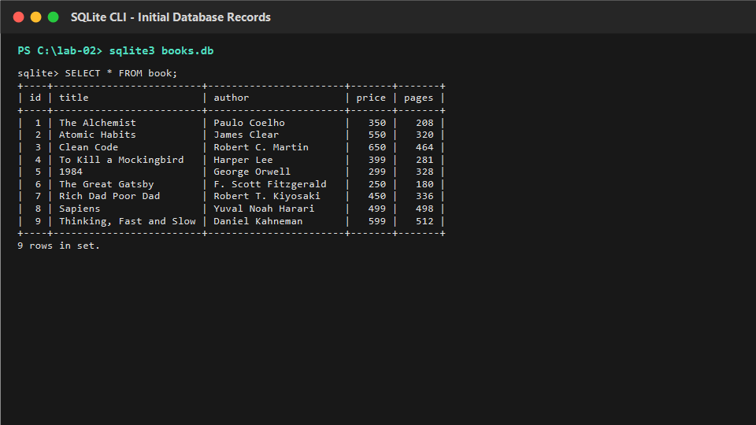

2. **GET /books/ (Retrieve all books)**
   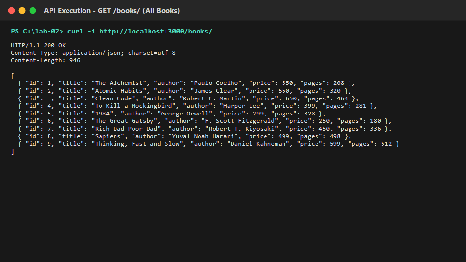

3. **GET /books/:bookId/ (Retrieve book by existing ID)**
   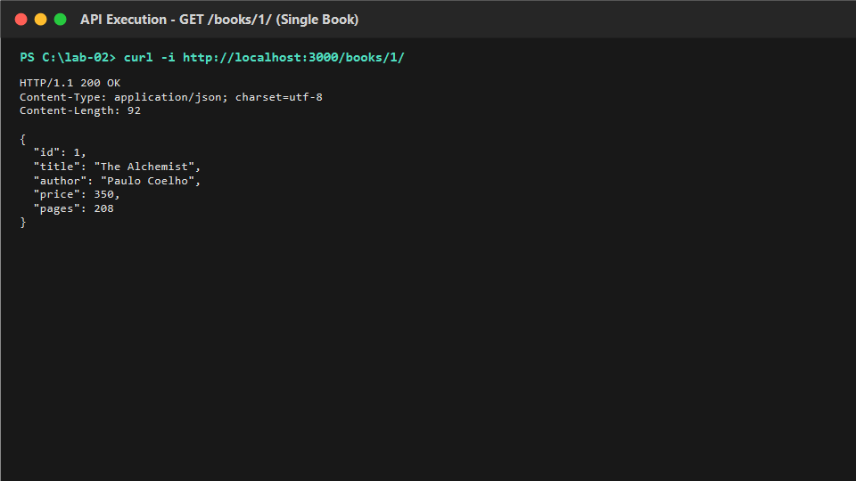

4. **GET /books/:bookId/ (Error: Non-existent ID -> 404)**
   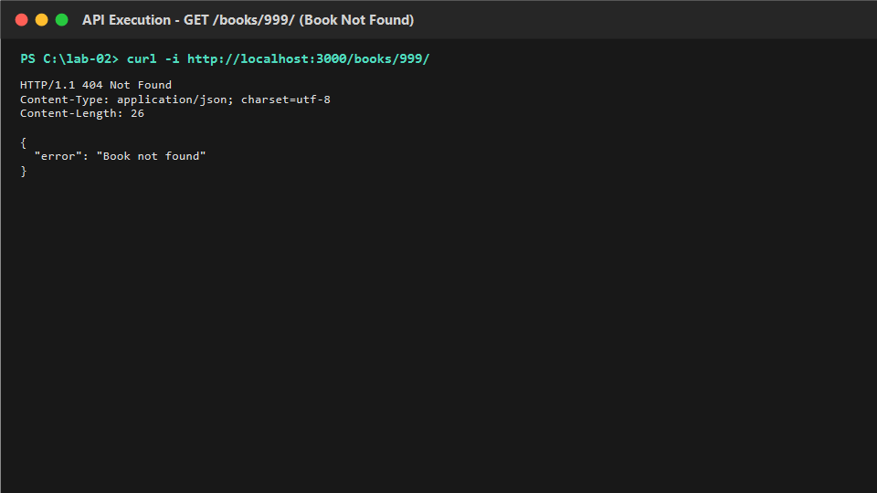

5. **POST /books/ (Add new book -> 201 Created with new ID)**
   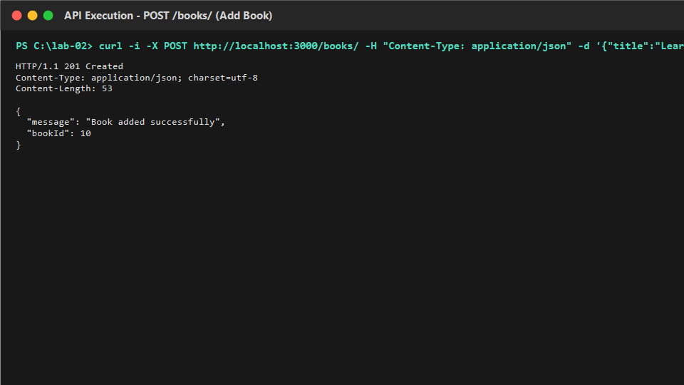

6. **SQLite CLI Verification after POST (Showing newly created book row)**
   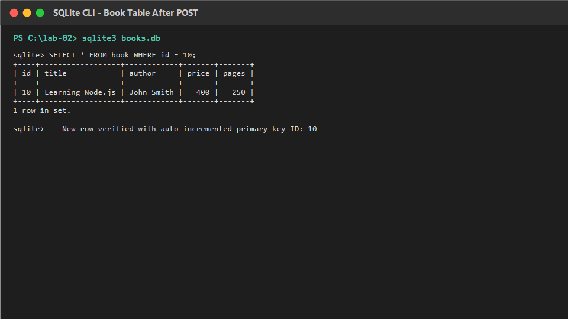

7. **POST /books/ (Error: Missing required fields -> 400 Bad Request)**
   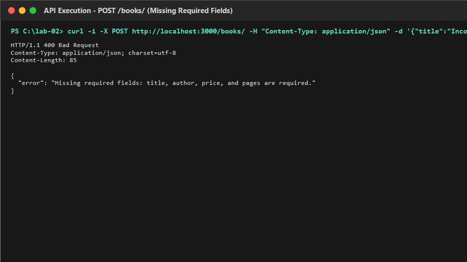

8. **PUT /books/:bookId/ (Update existing book -> 200 OK)**
   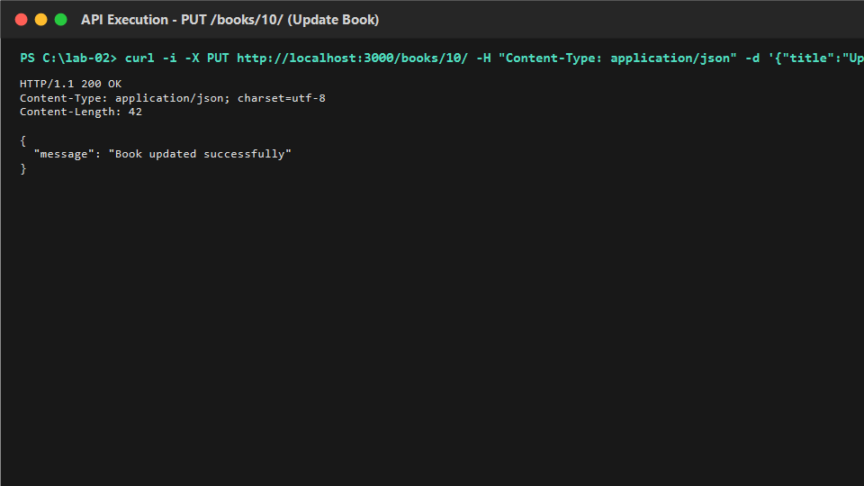

9. **SQLite CLI Verification after PUT (Showing updated book values)**
   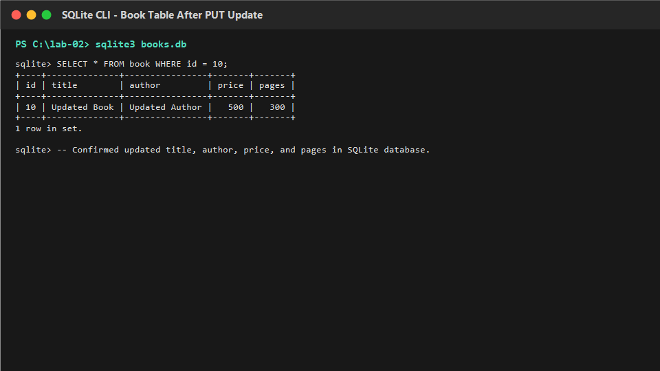

10. **PUT /books/:bookId/ (Error: Non-existent ID -> 404 Not Found)**
    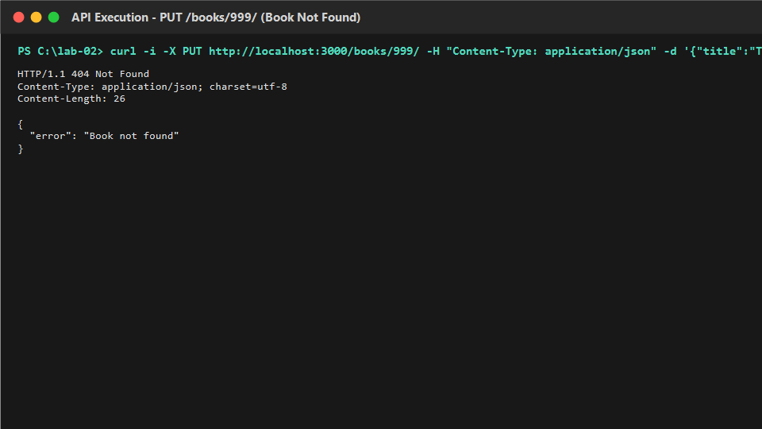

11. **DELETE /books/:bookId/ (Delete existing book -> 200 OK)**
    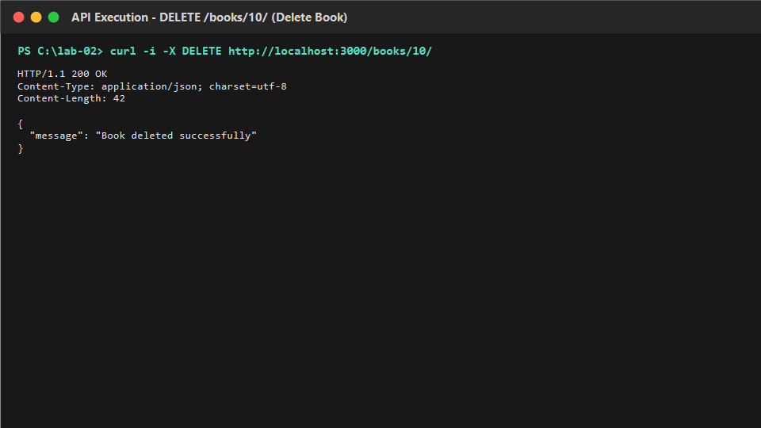

12. **SQLite CLI Verification after DELETE (Showing book record removed)**
    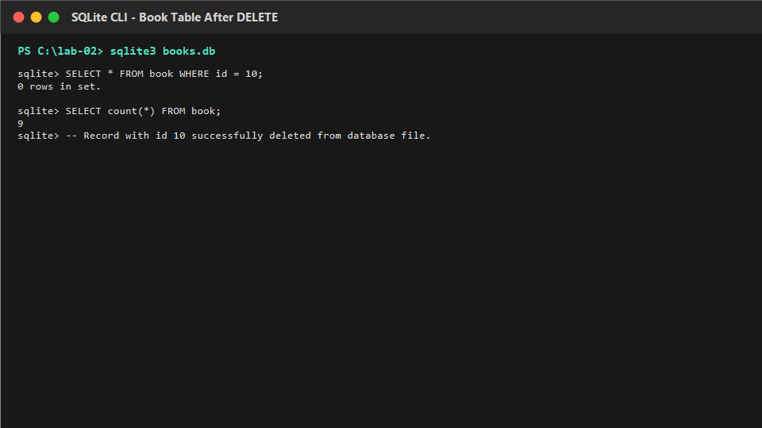

13. **DELETE /books/:bookId/ (Error: Non-existent ID -> 404 Not Found)**
    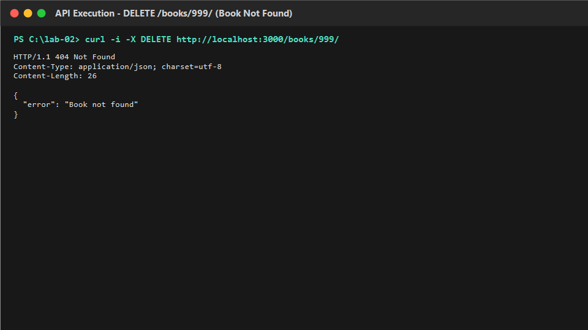

14. **SQL Injection Security Test (Proving ? placeholders neutralize malicious payloads)**
    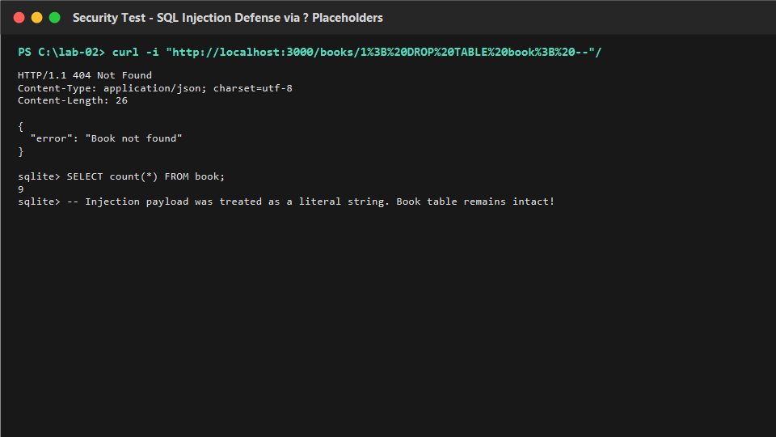

---

## Notes: problems faced and how you solved them

### 1. Database Connection Synchronization & Startup Sequencing
- **Problem**: In an asynchronous Node.js application, if `app.listen()` is executed before the SQLite database file connection is established, incoming HTTP requests arrive while `db` is still `null`, resulting in crashes with `TypeError: Cannot read properties of null (reading 'all')`.
- **Solution**: Implemented `initializeDBAndServer()` as a single `async` function. The database is opened via `await open({ filename: dbPath, driver: sqlite3.Database })`, database tables are verified, and `app.listen(PORT, ...)` is called only after the promise successfully resolves. Any connection failure is caught in `try...catch` block, logged, and gracefully terminated via `process.exit(1)`.

### 2. SQL Injection Vulnerabilities & Parameterized Query Binding
- **Problem**: When constructing SQL queries by concatenating user input (`SELECT * FROM book WHERE id = ${req.params.bookId}`), malicious input like `1; DROP TABLE book; --` can manipulate the SQL statement and destroy or expose database records.
- **Solution**: Strictly implemented parameterized queries using `?` placeholders across all routes (`db.get(query, [bookId])`, `db.run(query, [title, author, price, pages])`). SQLite treats placeholder values strictly as literal strings/values, preventing SQL injection attacks even when malformed inputs are submitted.

### 3. Idempotency & Semantics of PUT vs. POST
- **Problem**: Distinguishing when `PUT` should be used instead of `POST`, and ensuring proper status codes and error handling when a client attempts to update a non-existent entity.
- **Solution**: Followed REST principles: `POST` creates a new resource (returning `201 Created` and the auto-generated `bookId`). `PUT` replaces an existing resource at a specific URI (`/books/:bookId/`). Before executing the `UPDATE` statement in the `PUT` route, an explicit check (`SELECT * FROM book WHERE id = ?`) verifies whether the resource exists; if not found, a `404 Not Found` response is returned instead of silently ignoring the update.

### 4. Deployment Considerations for SQLite
- **Problem**: SQLite is an in-process, file-based database residing directly in the project file system (`books.db`). Standard serverless hosting platforms (like Vercel or AWS Lambda) spin up ephemeral containers that wipe out file changes whenever instances restart or scale to zero.
- **Solution**: For persistent deployment, containerized services supporting persistent storage disks (such as Render Web Services with a Render Disk, Railway Volumes, or Fly.io) should be used. The server is configured to dynamically bind to `process.env.PORT` to adapt seamlessly to cloud container environments.
